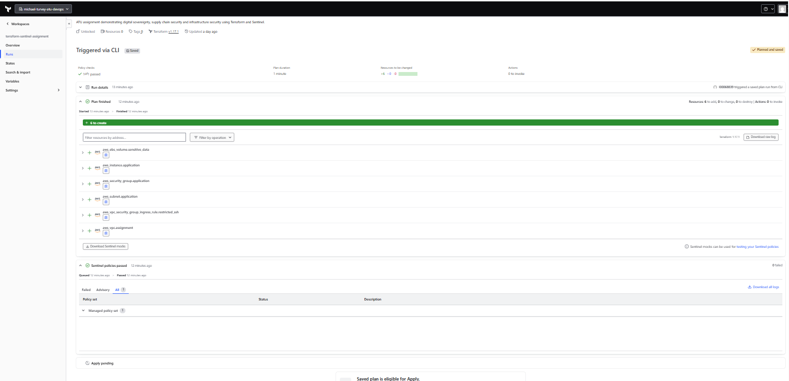
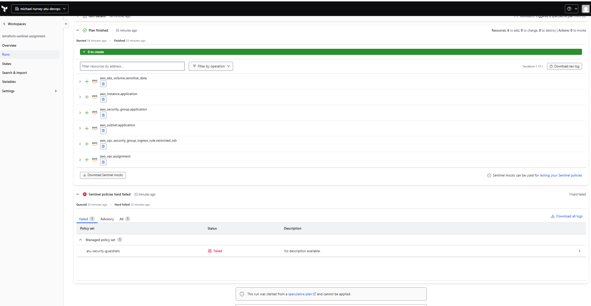

# Terraform and Sentinel: Digital Sovereignty and Supply Chain Security

**Author:** Michael Turvey  
**Student ID:** L00068839  
**Module:** ATU DevOps

## Purpose

This assignment implements a Policy-as-Code framework using Terraform and
HashiCorp Sentinel. It demonstrates how policies can reject non-compliant
infrastructure plans before deployment.

The example organisation requires infrastructure and sensitive storage to
remain in Ireland. It also restricts infrastructure settings and the sources
and versions of Terraform dependencies.

## Environment

- Terraform CLI: 1.17.0 on Windows.
- HCP Terraform run environment: Terraform 1.17.1.
- Local Sentinel CLI: 0.41.0.
- AWS provider: hashicorp/aws, pinned to 6.55.0.
- HCP organisation: michael-turvey-atu-devops.
- HCP workspace: terraform-sentinel-assignment.
- Policy: atu-security-guardrails, enforced as hard mandatory.

The AWS configuration uses dummy credentials and skips account validation
for plan-only testing. The AMI ID is a placeholder. No AWS resources were
deployed. This configuration requires changes before any real deployment.

## Project structure

| Folder | Contents |
|---|---|
| terraform | Infrastructure definitions, provider lock file and saved tfplan |
| policies | Sentinel policy, mock data and test configurations |
| evidence | HCP run output, local test results and screenshots |
| reports | One-page technical report |

## Infrastructure

The plan contains six resources: a VPC, private subnet, security group,
standalone SSH ingress rule, EC2 instance and encrypted EBS volume.

The EC2 instance references the subnet and security group. Its root storage
is encrypted, IMDSv2 is required and public IP assignment is disabled.
SSH is restricted to the example management subnet, 10.20.10.0/24.

The separate EBS volume demonstrates sensitive-storage controls. It is not
attached to the instance.

## Policy controls

| Control | Implementation |
|---|---|
| Storage residency | EBS availability zone must be an approved Ireland zone |
| Storage encryption | Standalone EBS volumes must be encrypted |
| Compute residency | EC2 availability zone must be an approved Ireland zone |
| Instance type | Only t3.micro and t3.small are approved |
| Root encryption | EC2 root block devices must be encrypted |
| Instance metadata | Metadata options must require IMDSv2 |
| Public IP | EC2 public IP assignment must be false |
| Inbound sources | Standalone ingress rules must use 10.20.10.0/24 |
| Provider source and version | Only registry.terraform.io/hashicorp/aws with an exact 6.55.0 constraint |
| Module source and version | Only the allowlisted VPC module with an exact 6.0.1 constraint |

The module allowlist is an assignment design choice, not a claim that
allowlisting proves a module is secure.

## Validation and evidence

HCP Terraform accepted the compliant configuration. Separate runs rejected:

- Unencrypted EBS storage.
- EBS storage outside the approved Ireland zones.
- An unapproved EC2 instance type.
- Optional IMDSv2.
- Public IP assignment.
- Unrestricted inbound SSH.
- A loose provider version constraint.

Four local Sentinel mock test cases passed:

- Approved provider and module.
- Rejection of an unapproved module source.
- Rejection of an unapproved module version.
- Rejection of an unapproved provider source.

A rejection test passes when Sentinel returns the expected false result.
These supply chain tests use an empty infrastructure mock and do not
independently test the infrastructure rules.

The live Terraform configuration contains no module calls. Its passing
module result alone is therefore not evidence of module enforcement;
the mock tests exercise that control explicitly.

## Running checks

From the terraform folder, run:

    terraform init
    terraform fmt -check
    terraform validate
    terraform plan

From the policies folder, run:

    sentinel test -verbose

The Sentinel executable must be on PATH, or invoked using its full path.

HCP evaluates the policy after planning. A hard mandatory failure blocks
progression to apply. Policies are updated manually in HCP. GitHub does
not automatically synchronise the policy set.

## Saved plan

terraform/tfplan is an HCP saved-plan reference, rather than a portable
local binary plan. Inspecting it requires access to the associated HCP run.
It may become stale or unavailable.

evidence/tfplan-readable.txt preserves the readable six-resource plan.

## Screenshots

Passing policy evaluation:

Failing policy evaluation:

## Digital sovereignty and data residency

Policy-as-Code turns selected organisational requirements into repeatable
checks. Rejecting an incorrect location during planning is more reliable
than relying only on a manual review. Git history also makes changes to
the rules visible and reviewable.

Ireland is the approved deployment location for this example. The policy
checks the availability zones of EC2 instances and standalone EBS volumes.
It does not enforce the region of every AWS resource or service.

Keeping a resource in Ireland is only one part of sovereignty. It does not
prove where every copy of its data exists, who can administer it, or which
jurisdictions may affect the service provider. Legal and contractual
requirements need separate assessment.

### Backups and replication

This implementation does not configure or enforce backup and replication
policies. A production extension should inspect backup vaults, snapshot
copies and replication destinations, with an explicit allowlist of approved
locations. Restore procedures, retention and deletion also need testing.

### Administrative access

A regional deployment does not restrict an administrator's physical
location. Production controls should include least-privilege access,
strong authentication, audited privileged access and reviewed support
arrangements. These are recommendations, not controls demonstrated here.

### Control-plane data

Terraform state, plans, logs, GitHub content and HCP metadata have their own
storage and access arrangements. This assignment does not establish Irish
residency for those systems. No real customer data is used.

## Supply chain integrity

The policy checks provider source addresses and exact version constraints.
The committed .terraform.lock.hcl records the selected provider and package
hashes. These controls support repeatability and dependency verification.

Module declarations are checked against an explicit source and version
allowlist. An approved address or pinned release does not prove that its
contents are safe. Dependency changes still require source review,
provenance checks and vulnerability assessment.

The provider lock file does not lock remote module contents. Module
provenance and release integrity therefore need additional controls.

Sentinel runs after Terraform initialisation and planning. It cannot prevent
a malicious provider from executing during those earlier stages. Restricted
runners, controlled downloads and verified dependencies are needed alongside
plan-time policy enforcement.

## Limitations

- Only selected resource types and attributes are inspected.
- The inbound-source check covers standalone
  aws_vpc_security_group_ingress_rule resources. Inline security group
  rules, legacy rule resources, network ACLs and other paths are not covered.
- The management subnet allowlist is deliberately restrictive. It does not
  implement a general network policy or restrict every permitted port.
- Root encryption is checked, but additional inline EC2 EBS devices are not.
- Unknown or absent values are rejected by several checks, but this is not
  a comprehensive treatment of every unknown plan attribute.
- Rules over empty collections can pass without exercising a control.
- Plan-time checks do not detect later console changes or runtime drift.
- Mock tests verify supplied scenarios, not the behaviour of live AWS.
- The AMI is a placeholder and account validation is disabled for this
  plan-only exercise. Successful plans do not prove deployability.
- Policies are maintained manually in HCP, creating a risk of differences
  between the enforced policy and the GitHub copy.

## Maintenance and recommendations

Review policies when provider schemas, infrastructure patterns or approved
dependencies change. Update allowlists through reviewed commits and rerun
both acceptance and rejection tests.

Extend resource coverage, add infrastructure mock tests and inspect backups
and replication before claiming broader sovereignty enforcement. Use runtime
monitoring to detect changes made outside Terraform.

For production, automate policy synchronisation, protect changes with peer
review and test against the same Sentinel runtime used by HCP. Manage secrets
outside source control and use genuine deployment credentials only within
an appropriately controlled environment.

## AI assistance

Substantial AI assistance was used for code, troubleshooting and
documentation. See [AI-USAGE.md](AI-USAGE.md) for the tool information,
recorded prompts and division of contributions.

## Policy configuration and test scenarios

- [Sentinel policy configuration](policies/sentinel.hcl) records the policy
  source and hard mandatory enforcement level. HCP is configured separately.
- [Test scenarios](policies/test-scenarios.md) maps acceptance and rejection
  cases to recorded evidence and identifies coverage gaps.
- [Technical report](reports/Terraform_Sentinel_Technical_Report.pdf)
  summarises results, limitations and recommendations.
